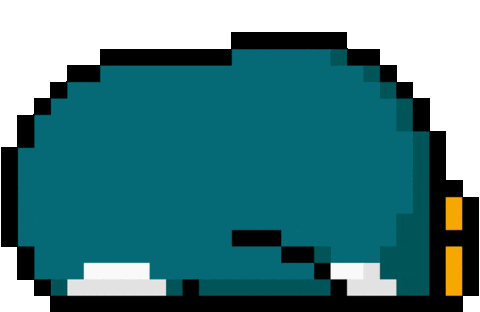
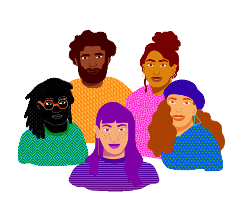

<h2> नमस्ते (Namaste) 🙏🏻, I'm Divyansh Barodiya! </h2>


<p><em>
  Building <a href="https://github.com/Divyansh151005/Temporal-Hypergraph-Engine"><b>Temporal Hypergraph Engine</b></a> — time-aware memory for LLMs
  
  <br/>
  Software Engineering Intern at <b>Arista Networks</b>
  
  <br/>
  B.Tech Computer Science at <a href="https://www.iitrpr.ac.in/"><b>IIT Ropar</b></a>
  
  <br/>
  Published at IEEE — <a href="https://ieeexplore.ieee.org/document/11575533"><b>DualCare</b></a>
  
</em></p>

[](https://temporal-hypergraph-web.onrender.com/)
[](https://www.linkedin.com/in/divyansh-barodiya/)
[](mailto:2023csb1119@iitrpr.ac.in)


###  A little more about me...

```javascript
const divyansh = {
  pronouns: ["he", "him"],
  location: "Pune, Maharashtra, India",
  currentFocus: "Temporal Hypergraph Engine — LLM memory that never serves a stale fact",
  code: ["Rust", "Python", "TypeScript", "Java", "C++", "Solidity"],
  askMeAbout: [
    "LLM memory & RAG",
    "distributed databases",
    "zero-knowledge proofs",
    "quantitative finance",
    "quantum error correction",
  ],
  building: {
    temporalHypergraphEngine: "lock-free temporal hypergraph + vLLM KV-cache store",
    aetherDecoders: "FTQC decoders — Union-Find + Relay-BP",
    zkCoprocessor: "ZK-verified off-chain compute for smart contracts",
    alphaEngine: "event-driven crypto multi-alpha engine",
  },
  research: "DualCare — dual-consent cross-chain medical data sharing (IEEE)",
  hackathons: ["MedinosXAdvitya 🥇", "Ideathon 🥇", "Sustainovate 🥈", "Edify 🥈"],
  openSource: ["apple/foundationdb", "vercel/turborepo", "anthropics/buffa", "lballabio/QuantLib"],
};
```

 <em><b>I love connecting with different people</b>, so if you want to say <b>hi</b>, I'd be happy to meet you!</em>

<br clear="right"/>
<br/>


<table>
<tr>
<td align="center" width="33%">
<h2>0%</h2>
<b>stale facts</b><br/>
<sub>multi-hop retrieval vs ~45–52% vector/graph RAG</sub>
</td>
<td align="center" width="33%">
<h2>7.8×</h2>
<b>faster p50</b><br/>
<sub>vs temporal property graph (identical accuracy)</sub>
</td>
<td align="center" width="33%">
<h2>375 ns</h2>
<b>p99 snapshot</b><br/>
<sub>under heavy concurrent writers</sub>
</td>
</tr>
</table>

<br/>

> **Time-aware memory for LLMs that never serves a stale fact.**  
> Lock-free, SIMD-accelerated **temporal hypergraph** in Rust — Python/TS SDKs, zero-copy **vLLM KV-cache** block store, [PyPI](https://pypi.org/project/hypergraph-client/) & [npm](https://www.npmjs.com/package/@temporal-hypergraph/sdk).

<br/>

<a href="https://github.com/Divyansh151005/Temporal-Hypergraph-Engine">
  
</a>

<br/>


<!--START_SECTION:merged-->
<p align="center">
  
  
</p>

<table>
<tr>
<td width="64" align="center"></td>
<td><b><a href="https://github.com/apple/foundationdb">apple/foundationdb</a></b> <sub>· 2 merged</sub><br/><a href="https://github.com/apple/foundationdb/pull/14313">#14313</a> Bound shard location batches in getStorageMetricsLargeKeyRange <sub>· 2026-11-03</sub><br/><a href="https://github.com/apple/foundationdb/pull/14308">#14308</a> [release-7.4] Fix SIGSEGV when opening a tenant on a database with an unusable cluster file <sub>· 2026-10-29</sub></td>
</tr>
<tr>
<td width="64" align="center"></td>
<td><b><a href="https://github.com/lballabio/QuantLib">lballabio/QuantLib</a></b> <sub>· 2 merged</sub><br/><a href="https://github.com/lballabio/QuantLib/pull/2915">#2915</a> Price deep in-the-money calls on the Leisen-Reimer tree <sub>· 2026-10-30</sub><br/><a href="https://github.com/lballabio/QuantLib/pull/2914">#2914</a> Floor finite-difference American prices at the exercise value <sub>· 2026-10-23</sub></td>
</tr>
<tr>
<td width="64" align="center"></td>
<td><b><a href="https://github.com/anthropics/buffa">anthropics/buffa</a></b> <sub>· 2 merged</sub><br/><a href="https://github.com/anthropics/buffa/pull/395">#395</a> buffa-build: path-scoped preserve_unknown_fields_in <sub>· 2026-09-20</sub><br/><a href="https://github.com/anthropics/buffa/pull/394">#394</a> types: add Api, Type, and SourceContext well-known types <sub>· 2026-09-01</sub></td>
</tr>
<tr>
<td width="64" align="center"></td>
<td><b><a href="https://github.com/K-Dense-AI/scientific-agent-skills">K-Dense-AI/scientific-agent-skills</a></b> <sub>· 2 merged</sub><br/><a href="https://github.com/K-Dense-AI/scientific-agent-skills/pull/245">#245</a> fix(database-lookup): retire dead PatentsView search API for ODP <sub>· 2026-09-10</sub><br/><a href="https://github.com/K-Dense-AI/scientific-agent-skills/pull/244">#244</a> fix(rdkit): finish FractionCSP3 / CalcFractionCSP3 doc corrections <sub>· 2026-09-10</sub></td>
</tr>
<tr>
<td width="64" align="center"></td>
<td><b><a href="https://github.com/vercel/turborepo">vercel/turborepo</a></b> <sub>· 5 merged</sub><br/><a href="https://github.com/vercel/turborepo/pull/13905">#13905</a> fix: Correct devtools --port default in CLI help <sub>· 2026-09-01</sub><br/><a href="https://github.com/vercel/turborepo/pull/13883">#13883</a> docs: Align CONTRIBUTING Node and pnpm versions <sub>· 2026-08-31</sub><br/><a href="https://github.com/vercel/turborepo/pull/13902">#13902</a> docs: Document missing reference flags and fix query typo <sub>· 2026-08-31</sub><br/><a href="https://github.com/vercel/turborepo/pull/13891">#13891</a> fix: Update --filter help links to canonical docs URL <sub>· 2026-08-31</sub><br/><a href="https://github.com/vercel/turborepo/pull/13892">#13892</a> docs: Clarify turbo ls stability in Agent Skill <sub>· 2026-08-30</sub></td>
</tr>
</table>

<p align="right"><sub>Auto-updated daily from GitHub search</sub></p>
<!--END_SECTION:merged-->

<sub>Also contributing to <a href="https://github.com/meta/pyrefly"><b>meta/pyrefly</b></a> (type checker narrowing &amp; inference) and <a href="https://github.com/google/guava"><b>google/guava</b></a> (collections <code>removeIf</code> on filtered views) — in review.</sub>

<br/>


<br/><br/>


<picture>
  <source media="(prefers-color-scheme: dark)" srcset="https://github-readme-stats.vercel.app/api?username=Divyansh151005&show_icons=true&theme=tokyonight&hide_border=true&bg_color=0d1117&title_color=f97316&icon_color=0ea5e9&include_all_commits=true&count_private=true" />
  <source media="(prefers-color-scheme: light)" srcset="https://github-readme-stats.vercel.app/api?username=Divyansh151005&show_icons=true&theme=default&hide_border=true&include_all_commits=true&count_private=true" />
  
</picture>
&nbsp;
<picture>
  <source media="(prefers-color-scheme: dark)" srcset="https://github-readme-streak-stats.herokuapp.com/?user=Divyansh151005&theme=tokyonight&hide_border=true&background=0D1117&ring=f97316&fire=0ea5e9&currStreakLabel=f97316" />
  <source media="(prefers-color-scheme: light)" srcset="https://github-readme-streak-stats.herokuapp.com/?user=Divyansh151005&theme=default&hide_border=true" />
  
</picture>
&nbsp;
<picture>
  <source media="(prefers-color-scheme: dark)" srcset="https://github-readme-stats.vercel.app/api/top-langs/?username=Divyansh151005&layout=compact&theme=tokyonight&hide_border=true&bg_color=0d1117&title_color=f97316&langs_count=8" />
  <source media="(prefers-color-scheme: light)" srcset="https://github-readme-stats.vercel.app/api/top-langs/?username=Divyansh151005&layout=compact&theme=default&hide_border=true&langs_count=8" />
  
</picture>

<br/><br/>


<br/>

[](https://github.com/Divyansh151005)

<br/>


<picture>
  <source media="(prefers-color-scheme: dark)" srcset="https://raw.githubusercontent.com/Divyansh151005/Divyansh151005/master/assets/github-contribution-grid-snake-dark.svg" />
  <source media="(prefers-color-scheme: light)" srcset="https://raw.githubusercontent.com/Divyansh151005/Divyansh151005/master/assets/github-contribution-grid-snake.svg" />
  
</picture>

<br/><br/>


<div align="center">

**Open to collaborations, research, and hard systems problems.**

</div>
